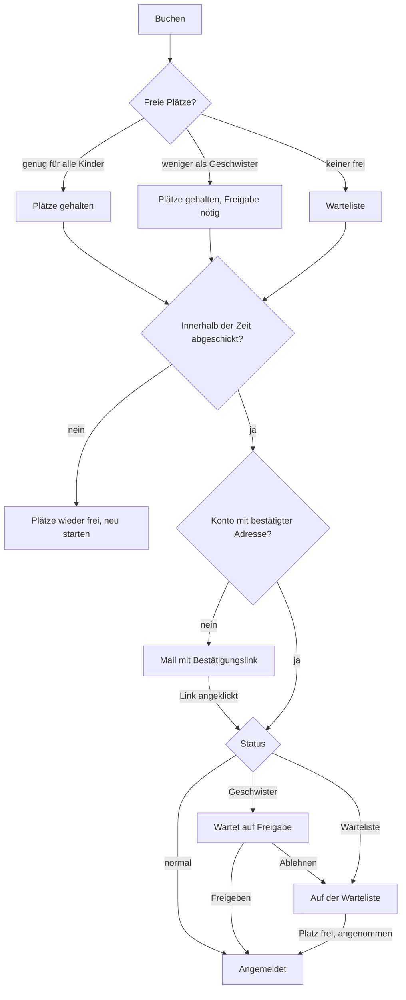

# Z-LAB Cockpit & Homepage – Dokumentation

Stand: 14.10.2026 · Phasen 1–6 des [Plans](PLAN.md) sind umgesetzt.

Ein allgemein verständlicher Überblick über die Funktionen steht in [doc/ueberblick.md](doc/ueberblick.md).

## Überblick

Eine Anwendung, zwei Seiten: Das **Cockpit** unter `/cockpit` ist für das Team, die **Homepage** unter `/` für Eltern, Kinder und Schulen. Alles, was auf der Homepage steht, wird im Cockpit gepflegt.

| Wer | Wo | Was |
| --- | --- | --- |
| Team | `/cockpit` (Login mit Benutzerkonto) | Homepage-Inhalte, Kurse, Durchführungen, Anmeldungen, Freigaben, Anwesenheit, Kontakte, Einstellungen |
| Kursverantwortliche | Mail + `/cockpit` | Freigaben für Geschwister und Warteliste entscheiden, Schulanfragen bestätigen, Erinnerungen zu Schulbesuchen |
| Eltern | `/` | Kurse ansehen, Kinder anmelden, optional Konto unter `/konto` |
| Schulen und Lehrkräfte | `/schulen` | Schulkonto, Lehrkräfte einladen, Termine für Klassen anfragen, stornieren, verschieben |
| Alle Besucher | `/kurse`, `/kalender`, `/kontaktformular` | Kursliste, Kalender, Kontakt |

## Homepage pflegen

Die Homepage besteht aus **Bereichen**, die als Kacheln angezeigt werden. Man sieht immer nur eine Ebene und klickt sich nach unten durch. Gepflegt wird unter **Homepage → Bereiche**.

- **Hierarchie:** Ein Bereich bekommt einen übergeordneten Bereich. Die Startseite zeigt die Hauptbereiche, jede Bereichsseite (`/{kurzname}`) ihren Inhalt und darunter ihre Unterbereiche als Kacheln, mit Brotkrümeln zurück.
- **Kachel:** Kurztext, Kachelbild (Alt-Text ist Pflicht) und Darstellung (Standard, Hervorgehoben, Breit). Die Reihenfolge wird per Drag & Drop in der Tabelle festgelegt.
- **Inhalt:** Blöcke Text, Bild, Text mit Bild, Call-to-Action, Kontakt/Adresse, Kontaktformular, Kursliste (gefiltert nach Interessen/Zielgruppe) und Kurskalender.
- **Sichtbar / Kopfzeile / Nicht als Kachel:** Ausgeblendete Bereiche sind samt Unterbereichen nicht erreichbar. „Nicht als Kachel“ ist für Seiten wie Impressum und Datenschutz, die nur im Footer verlinkt werden.

**Firmeninfos** (Verwaltung → Firmeninfos), in Tabs:

| Tab | Inhalt |
| --- | --- |
| Firma | Name, Adresse, Kontakt-E-Mail, Telefon, Logo (mit Alt-Text) |
| Anwendung | Titel der Anwendung (Cockpit, Browser-Tab, Mail-Absender), Cockpit-Farben |
| Homepage | Titel, Slogan, Haupt- und Akzentfarbe |
| Footer | Copyright-Text, Links (auf Bereiche oder externe Adressen), Social Media |
| Kursbuchung | Fristen und Grenzen der Anmeldung, siehe [Regeln](#regeln-und-einschränkungen) |

Alle Mails tragen oben Logo bzw. Homepage-Titel, unten Adresse, Kontakt und Impressum-Link.

## Kurse online stellen

Ein **Kurs** ist die Vorlage, eine **Durchführung** das buchbare Angebot mit Plätzen, ein **Termin** ein einzelner Tag mit Uhrzeit. Auf der Homepage erscheint eine Durchführung, sobald Kurs und Durchführung veröffentlicht sind und mindestens ein Termin in der Zukunft liegt.

1. **Interessen** pflegen (Kurse und Kinder → Interessen). Nach dieser Liste werden Kurse eingeordnet und Kinder zugeordnet.
2. **Darstellungsvorlage** wählen oder anlegen (→ Darstellungsvorlagen): Stil der Visitenkarte, Layout der Detailseite, Akzentfarbe, Ersatzbilder, Zusatzinhalt. Eine Vorlage ist der Standard.
3. **Kurs anlegen** (→ Kurse), drei Tabs:
    - Visitenkarte: Name, Kurztext, kleines Bild + Alt-Text
    - Detailseite: großes Bild + Alt-Text, Beschreibung
    - Einstellungen: Zielgruppe, Vorlage, Interessen, Gürtel, Altersspanne, Dauer, vorgeschlagene Plätze und Warteliste, **Kursverantwortliche\*r (Pflicht)**, Frist für Nachrücker, „Auf der Homepage veröffentlicht“
4. **Durchführung anlegen** (am Kurs „Neue Durchführung“ oder → Durchführungen): Status, Plätze, Warteliste (optional mit Obergrenze), Anmeldezeitraum, Ort, abweichende\*r Verantwortliche\*r, Nachrückfrist, beliebig viele Termine.
5. **Status „Veröffentlicht“** setzen. Beim Anlegen kann zusätzlich „Interessierte gleich benachrichtigen“ aktiviert werden.

Der Kurs erscheint dann an drei Stellen:
- unter `/kurse` als Raster mit Filtern nach Interesse, Alter und Zielgruppe
- auf seiner Detailseite `/kurse/{name}` mit allen Durchführungen
- im Kalender `/kalender`

Kursliste und Kalender lassen sich zusätzlich als Blöcke in Bereiche setzen. Im Cockpit öffnet das Globus-Symbol „Auf der Homepage ansehen“ die echte Seite.

## Anmeldung durch Eltern

Eine Anmeldung ist erst verbindlich, wenn die E-Mail-Adresse bestätigt ist. Ein Konto braucht man dafür nicht.

Jede Buchung gilt für genau einen Kurstermin (eine Durchführung). Einen Warenkorb gibt es nicht.

1. **Buchen:** Auf der Kursseite die Anzahl der Kinder wählen und auf „Buchen“ klicken. Die Plätze werden sofort für alle anderen gesperrt und die Buchungsseite öffnet sich mit einem sichtbaren **Countdown** (Standard 15 Minuten). Ein zweiter Klick auf denselben Termin führt zur laufenden Buchung zurück.
2. **Buchungsseite:** Pro Platz ein Kind eintragen, mit Name und Geburtsdatum. Angemeldete Eltern wählen ihr gespeichertes Kind aus. Fehlt bei einem gespeicherten Kind das genaue Geburtsdatum, wird es hier abgefragt. Dazu kommen Kontaktdaten mit **Pflicht-Telefonnummer für Rückfragen** und die Datenschutz-Zustimmung, optional ein Abo für Kursinfos. „Abbrechen“ gibt die Plätze sofort wieder frei.
3. **Zeit abgelaufen:** Wird die Seite nicht rechtzeitig abgeschickt, sperrt ein Hinweis das Formular und die Plätze werden wieder frei. Die Buchung muss dann neu gestartet werden.
4. **Prüfungen beim Absenden:** Alter am ersten Termin, kein Kind doppelt im Kurs (auch nicht aus einer früheren Buchung), Buchungsgrenzen. Bei einem Verstoß erscheint eine Meldung am betroffenen Kind, bei Buchungsgrenzen mit Wartezeit.
5. **Bestätigung:** Gäste bekommen eine Mail mit einem Bestätigungslink (Standard 48 Stunden gültig). Erst danach werden Kontakt und Kinder angelegt. Angemeldete Eltern mit bestätigter Adresse sind sofort verbindlich angemeldet. Der Countdown gilt nur bis zum Absenden.
6. **Bestätigungsmail** mit allen Terminen und einem Link zum Verwalten bzw. Stornieren, für die ganze Anmeldung oder einzelne Kinder.

## Regeln und Einschränkungen

Alle Werte stehen unter Firmeninfos → Kursbuchung. Die Nachrückfrist lässt sich pro Kurs und pro Durchführung überschreiben.

| Regel | Standard | Wirkung |
| --- | --- | --- |
| Zeit zum Buchen | 15 min | Vom Klick auf „Buchen“ bis zum Absenden; danach werden die Plätze wieder frei |
| Frist für E-Mail-Bestätigung | 48 h | Unbestätigte Anmeldungen verfallen |
| Frist für Nachrücker | 48 h | So lange kann eine Familie einen frei gewordenen Platz annehmen |
| Max. Kurse pro Kind und Stunde | 2 | Letzte 60 Minuten, 0 = aus |
| Max. Kurse pro Kind in 24 Stunden | 4 | Letzte 24 Stunden, 0 = aus |
| Max. Kinder pro Anmeldung | 5 | Auswahl „Anzahl Kinder“ |
| Kursinfos sammeln | 4 h | Wartezeit bis zur Sammelmail, siehe [Kursinfos](#kursinfos-an-interessierte) |

**Alter:** Das Geburtsdatum ist bei jeder Anmeldung Pflicht. Geprüft wird das Alter am ersten Termin gegen die Altersspanne des Kurses. Passt es nicht, kommt keine Anmeldung zustande.

**Buchungsgrenzen:**
- Gezählt werden Homepage-Anmeldungen, Wartelistenplätze eingeschlossen.
- Ein Kind wird über seinen Datensatz erkannt, bei Gästen über Name und Geburtsdatum.
- Die Meldung nennt, wann wieder gebucht werden kann, z. B. „in 23 Minuten (ab 15:00 Uhr)“.
- Anmeldungen im Cockpit sind ausgenommen.

**Geschwister:**
- Sind Plätze frei, aber weniger als angemeldete Geschwister, werden alle Plätze gehalten.
- Nach der E-Mail-Bestätigung heißt der Status „Wartet auf Freigabe“. Die kursverantwortliche Person bekommt eine Mail mit „Freigeben“ und „Ablehnen“.
- **Freigeben:** Alle Geschwister nehmen teil, der Kurs wird dadurch überbucht.
- **Ablehnen:** Die Familie kommt gemeinsam auf die Warteliste. Gibt es keine Warteliste, wird die Anmeldung abgelehnt.

**Warteliste:** strikt in Reihenfolge.
- Wird ein Platz frei, bekommt die nächste Familie die Mail „Platz frei“. Sie hat die Nachrückfrist, um ihn anzunehmen, sonst geht das Angebot weiter.
- Ist die nächste Familie größer als die freien Plätze, entscheidet die kursverantwortliche Person.
- **Freigeben:** Die Familie bekommt alle Plätze angeboten.
- **Ablehnen:** Die Plätze gehen an die nächsten Familien. Diese Familie bleibt vorne und wird beim nächsten freien Platz erneut gefragt.

**Kursverantwortliche:** Pflichtfeld am Kurs, an der Durchführung überschreibbar. Fehlt die Person, z. B. weil ihr Benutzer gelöscht wurde, gehen Anfragen an die Kontakt-E-Mail. Die Kurstabelle zeigt dann „fehlt“.

## Elternkonto

Das Konto ist freiwillig und kommt ohne Passwort aus: Eltern melden sich per Link aus einer Mail an (Magic Link, 30 Minuten gültig, nur einmal verwendbar).

- **Anmelden / Registrieren** unter `/anmelden`:
  - E-Mail eingeben, den Link anklicken und auf der Seite „Jetzt anmelden“ bestätigen. Neue Kontakte entstehen erst mit diesem Klick.
  - Schutz: höchstens 3 Links pro Adresse in 10 Minuten, Honeypot gegen Bots, eine neutrale Antwort, die nicht verrät, ob die Adresse bekannt ist.
- **Mein Konto** `/konto`: Anmeldungen ansehen und stornieren, Kinder mit Geburtsdatum und Interessen pflegen, Kontaktdaten, Einwilligung für Kursinfos samt Sammelzeit und Wochenmaximum.
- **E-Mail ändern:**
  - Erst bestätigt die alte Adresse, dann die neue (Links jeweils 24 Stunden gültig).
  - Bei jeder Änderung bekommt die alte Adresse einen Hinweis, auch wenn im Cockpit geändert wurde.
  - Wer keinen Zugriff mehr auf die alte Adresse hat, wird zum Kontaktformular geleitet.
- **Konto löschen:** über das Kontaktformular (Anliegen „Konto löschen / Datenschutz“). Umgesetzt wird es im Cockpit.

**Datenschutz Geburtsdatum:** Das genaue Geburtsdatum sehen nur die Eltern, das Cockpit zeigt ausschließlich das Alter. Wird im Cockpit ein Alter eingegeben, speichert das System ein geschätztes Datum. Die Eltern ersetzen es später durch das echte.

## Kursinfos an Interessierte

Neue Kurse werden pro Familie gesammelt. Ist eine Weile kein weiterer passender Kurs dazugekommen, geht eine einzige Sammelmail raus.

1. Im Cockpit an der veröffentlichten Durchführung **„Interessierte benachrichtigen“** wählen, oder beim Anlegen den Schalter aktivieren. Interessen und Alter sind aus dem Kurs vorbelegt, die Zahl der Familien wird live angezeigt.
2. Der Kurs wird für jede passende Familie **vorgemerkt**, jede Familie höchstens einmal pro Durchführung.
3. Alle 15 Minuten prüft das System jede Familie. Es verschickt die **Sammelmail**, wenn beides zutrifft:
    - Seit der Sammelzeit (Standard 4 h) ist kein weiterer Kurs für die Familie dazugekommen.
    - Das Wochenmaximum ist nicht erreicht.

   Die Mail nennt pro Kurs die passenden Kinder, die Termine, die freien Plätze und den Anmeldelink.

**Wer passt:**
- Eltern mit Einwilligung und bestätigter E-Mail-Adresse.
- Mindestens ein Kind hat ein passendes Interesse und ist am ersten Termin im passenden Alter.
- Kinder ohne Geburtsdatum passen unabhängig vom Alter.

**Was Eltern im Konto einstellen:**
- Sammelzeit zwischen 1 Stunde und 1 Woche.
- Höchstens 1–7 Mails pro Woche oder unbegrenzt.

**Abmelden** geht über den Link in jeder Mail, über den Abmelde-Knopf des Mailprogramms oder im Konto.

Abgesagte oder vergangene Kurse fallen vor dem Versand heraus.

## Schulklassen

Kurse mit der Zielgruppe **Schulklassen** werden von Schulen gebucht. Jede Durchführung ist ein Termin für **genau eine Klasse**, ohne Warteliste (Plätze und Warteliste werden automatisch gesetzt).

**Ort pro Kurs** (Kurs → Reiter „Schulklassen“): nur im Z-LAB, nur in der Schule, oder beides – dann wählt die Lehrkraft bei der Buchung. Findet der Kurs in der Schule statt, gilt die Adresse der Schule.

**Konten:**
- Die Schule registriert sich unter `/schulen/registrieren` mit Name, Anschrift und einer **Funktionsadresse** (z. B. Sekretariat). Erst nach Bestätigung des Links kann sie sich anmelden.
- Im Schulkonto (`/schulen/konto`) lädt die Schule ihre **Lehrkräfte** ein. Jede Lehrkraft bekommt ein eigenes Unterkonto (Einladungslink 7 Tage gültig). Eine Adresse, die schon zu einem anderen Konto gehört (z. B. Eltern), wird abgelehnt – bitte die dienstliche Adresse nehmen.
- Das Schulkonto sieht alle Buchungen der Schule, eine Lehrkraft nur ihre eigenen. Mails an die Lehrkraft gehen in Kopie an die Funktionsadresse.
- Anmelden geht wie bei Eltern per Link unter `/anmelden`; Schulen und Lehrkräfte landen danach im Schulkonto.

**Für wen (Kurs → Reiter „Schulklassen“):** Statt eines Alters legt der Kurs fest, für welche **Schularten** (leer = alle) und **Klassenstufen** (von–bis) er gedacht ist, und optional eine **maximale Klassengröße**. Die Klassengröße lässt sich pro Durchführung überschreiben. Auf der Homepage steht dann z. B. „Klasse 3–4 · Grundschule · max. 28 Kinder“.

**Wer darf was buchen:** Kurse für Schulklassen kann nur ein Schulkonto (oder eine Lehrkraft der Schule) buchen. Umgekehrt kann ein Schulkonto keine Kurse für einzelne Kinder buchen; auf der Kursseite steht dann ein Hinweis statt des Buchen-Knopfs.

**Buchen:** Unter `/schulen/kalender` und `/schulen/termine` stehen alle Termine mit Status frei / wird gerade von einer anderen Schule gebucht / angefragt / vergeben (ohne Namen anderer Schulen). Ein Klick auf „Buchen“ reserviert den Termin mit demselben Countdown wie bei Eltern. Abgefragt werden Schulart, Klassenstufe, Klasse, **Anzahl der Kinder** (höchstens die maximale Klassengröße), Lehrkraft, **Telefon für Rückfragen (Pflicht)**, Thema/Anmerkung und ggf. der Ort. Schulart und Klassenstufe werden gegen den Kurs geprüft. Die Schulart der letzten Buchung ist vorausgewählt.

**Freigabe:** Jede Buchung ist zunächst eine **Anfrage**, die den Termin blockiert. Die Kursverantwortlichen bekommen eine Mail mit „Bestätigen“/„Ablehnen“ (optional mit Nachricht an die Schule) oder entscheiden im Cockpit. Bei Ablehnung wird der Termin wieder frei.

**Erinnerungen** (Befehl `app:send-school-reminders`, stündlich):
- an die **Lehrkraft** X Tage vor dem ersten Termin: „wir kommen zu Ihnen“ bzw. „Sie kommen zu uns“, Bitte, Schülerzahl und Thema zu prüfen, Link zum **Bestätigen** der Teilnahme (dort lässt sich die Schülerzahl korrigieren und eine Nachricht hinterlassen). Bei Besuchen im Z-LAB hängt die **Anfahrtsskizze** an (Firmeninfos → Schulklassen).
- an die **Kursverantwortlichen** Y Tage vorher, mit allen Daten zu Kurs, Schule und Ansprechpartner sowie den Notizen. Im Cockpit an der Anmeldung: **„Erinnerung verschieben“** (neuer Zeitpunkt, optional mit Notiz) und **„Notiz hinzufügen“**. Alle Notizen stehen an der Durchführung im Reiter „Notizen“.
- Bestätigt die Lehrkraft oder ändert sie etwas, bekommen die Kursverantwortlichen eine Mail.
- Einstellungen: Firmeninfos → Schulklassen (Standard), pro Kurs und pro Durchführung überschreibbar: Erinnerungen an/aus, Tage für Lehrkraft und Kursverantwortliche, Frist zum Stornieren/Verschieben.

**Stornieren und Verschieben:** Bis zur Frist (Tage vor dem ersten Termin) kann die Schule im Schulkonto oder über den Link in der Mail selbst stornieren oder auf einen anderen freien Termin desselben Kurses verschieben. Beim Verschieben bleibt der alte Termin bestehen, bis die Kursverantwortlichen den neuen bestätigen; bei Ablehnung bleibt alles beim Alten. Die Kursverantwortlichen werden jedes Mal informiert. Nach der Frist geht es nur noch telefonisch.

## Aufgaben im Cockpit

| Wo | Was |
| --- | --- |
| Kurse und Kinder → Anmeldungen | Tabs Aktiv, Freigabe nötig (Zähler in der Navigation, inkl. Schulanfragen), Schulklassen, Warten auf Bestätigung, Alle. Schulanfragen: Bestätigen/Ablehnen mit Nachricht, Erinnerung verschieben, Notiz hinzufügen. Aktionen: Bestätigen (ohne Mail-Link, z. B. nach Anruf), Freigeben, Ablehnen, Stornieren (wahlweise mit Info-Mail an die Eltern) |
| Durchführung → Teilnehmende | Belegung, Kind direkt anmelden (auch überbuchen), von der Warteliste aufnehmen, Freigabe entscheiden, abmelden |
| Durchführung → Notizen | interne Notizen, z. B. aus Gesprächen mit der Schule (Anfahrt, Besonderheiten); erscheinen in der Erinnerungsmail |
| Durchführung → Anwesenheit | Raster Kind × Termin zum Abhaken, „Alle anwesend“ für einen Termin; gespeichert wird, wer wann abgehakt hat |
| Kontakte → Kontakte | Eltern, Schulen und Lehrkräfte (Tabs), bei Schulen die eingeladenen Lehrkräfte, Kinder zuordnen, „Anmeldelink senden“, Einwilligung und Mail-Einstellungen |
| Kontakte → Kinder | Alter, Interessen, Eltern; Kurshistorie mit Anwesenheit (z. B. 4 / 5) |
| Kalender | zeigt zusätzlich alle Kurstermine |

Anfragen aus dem **Kontaktformular** (`/kontaktformular`, auch als Block in Bereichen) kommen als Mail an die Kontakt-E-Mail. „Antworten“ in der Mail erreicht direkt den Absender.

Wer was im Cockpit darf, wird über Rollen und Berechtigungen gesteuert (Shield). Für neue Bereiche müssen die Rechte `*:Section`, `*:Interest`, `*:CourseTemplate`, `*:CourseInstance`, `*:Contact` und `*:Registration` den Rollen zugewiesen werden.

## Betrieb

| Was | Warum |
| --- | --- |
| `php artisan migrate` | neue Tabellen und Felder |
| `npm install && npm run build` | Homepage-Assets, FullCalendar |
| `php artisan storage:link` | hochgeladene Bilder auf Homepage und in Mails |
| Cron `* * * * * php artisan schedule:run` | Reservierungen verfallen lassen und Warteliste nachrücken (jede Minute), Sammelmails (alle 15 Minuten), Erinnerungen zu Schulbesuchen (stündlich), bestehende Erinnerungen |
| `QUEUE_CONNECTION=database` + `php artisan queue:work` | Sammelmails werden über die Queue verschickt |
| echter Mailversand (`MAIL_MAILER`), korrekte `APP_URL` | ohne Mails keine verbindliche Gast-Anmeldung; Links und Logo in Mails |
| `php artisan db:seed --class=HomepageSeeder` (optional) | Startinhalte, Kurse und Interessen des Z-LAB |

**Vor dem Livegang offen:**
- Impressum prüfen.
- Eine eigene Datenschutzerklärung erstellen. Aktuell steht dort ein Platzhalter mit Link zur Stiftung.
- Kachel- und Kursbilder hochladen.
- Platzzahlen und Ferienkurs-Zeiten im Seeder prüfen.
- Bei allen Kursen eine verantwortliche Person eintragen.
- Anfahrtsskizze unter Firmeninfos → Schulklassen hochladen und bei Schulkursen den Ort festlegen.
